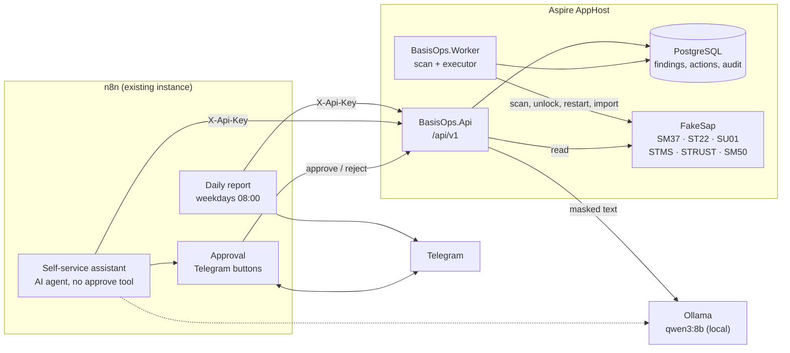

# Basis Ops Copilot

[](https://github.com/oykunyenal/basis-ops-copilot/actions/workflows/ci.yml)

**An approval-based, fully audited assistant that automates the morning checks of an SAP Basis team and the user requests
they handle again and again, with a local LLM that summarizes and explains, but never decides.**

.NET 10 · Aspire · PostgreSQL · n8n · Ollama (qwen3) · Microsoft.Extensions.AI · Telegram

## The problem

Every morning a Basis administrator opens the same transactions to see what went wrong overnight, and during the day
answers the same requests ("my user is locked") one by one. Both are repetitive. On production, both must stay controlled:
nothing changes without a second person, and every change is traceable.

| Manual task | SAP transaction | In this project |
|---|---|---|
| Canceled background jobs | SM37 | Periodic scan → finding (critical jobs → Critical) |
| Short dumps (ABAP runtime errors) | ST22 | Scan for dump storms + LLM analysis of a single dump |
| Locked users | SU01 | Self-service chat → unlock request → approval in Telegram → executed |
| Transport queue, failed imports | STMS | Scan by return code + approved import |
| Expiring certificates | STRUST | Warning at 30 days, critical at 7 days |
| Work process utilization | SM50 / SM66 | Threshold alerts for dialog work processes |

Every weekday at 08:00 a Telegram message summarizes the state of the system. A user can write
*"User MEHMET is locked on PRD"* in a chat, the assistant opens a request, the on-call Basis admin taps **Approve**,
and the worker unlocks the user within seconds, with the whole trail in the audit log.

> **There is no real SAP system behind this.** The `FakeSap` service simulates one (seeded data, new events over time,
> configurable failures). The code talks to it only through the `ISapGateway` interface; see
> [Connecting to a real SAP system](#connecting-to-a-real-sap-system).

## Architecture



- **Api** (minimal API): findings, health, action requests with approve / reject, audit log, daily report, dump analysis.
- **Worker**: scans every system every 60 s and executes approved actions, claiming them with `FOR UPDATE SKIP LOCKED`.
- **n8n**: the schedule, the chat and Telegram. It only calls the API; the rules are enforced by the API.
- **Ollama**: summaries and dump analysis. Optional: without it, everything still works, without AI.

More detail, including sequence diagrams for the scan, the approval flow and the AI calls: [docs/architecture.md](docs/architecture.md).

```
src/
├── BasisOps.AppHost/          Aspire orchestration (Postgres, FakeSap, Api, Worker)
├── BasisOps.ServiceDefaults/  OpenTelemetry, health checks, resilience
├── BasisOps.Domain/           Entities, health rules, action state machine (no package dependencies)
├── BasisOps.Application/      Use cases (command / query handlers), ports
├── BasisOps.Infrastructure/   EF Core, SAP gateway (anti-corruption layer), LLM adapter and masking
├── BasisOps.Api/              Minimal API (:5081)
├── BasisOps.Worker/           Periodic health scan + approved action executor
└── FakeSap/                   SAP simulator (:5090)
tests/                         Unit, integration (Testcontainers) and gateway contract tests
n8n/                           Workflows: daily report, self-service assistant, Telegram approval
```

Dependencies point inward: `Domain ← Application ← Infrastructure ← Api / Worker`.

## Run it in 5 minutes

Prerequisites: .NET 10 SDK and Docker. Optional: [Ollama](https://ollama.com) with `ollama pull qwen3:8b` for AI summaries.

```bash
git clone https://github.com/oykunyenal/basis-ops-copilot.git && cd basis-ops-copilot
dotnet user-secrets set "Parameters:api-key" "$(openssl rand -hex 24)" --project src/BasisOps.AppHost
dotnet run --project src/BasisOps.AppHost     # Aspire dashboard: Postgres, FakeSap, Api, Worker
```

Then, with the key from `dotnet user-secrets list --project src/BasisOps.AppHost`:

```bash
KEY=<your key>
curl -s -H "X-Api-Key: $KEY" localhost:5081/api/v1/systems                  # DEV, QAS, PRD with their health
curl -s -H "X-Api-Key: $KEY" "localhost:5081/api/v1/reports/daily?sid=PRD"  # findings + LLM summary
```

- Interactive API docs: `http://localhost:5081/scalar` (Development only).
- [`src/BasisOps.Api/BasisOps.Api.http`](src/BasisOps.Api/BasisOps.Api.http) walks through the whole flow:
  request an unlock → approve → watch the worker execute it → read the audit trail. Put the key into
  `src/BasisOps.Api/http-client.private.env.json` (gitignored): `{ "local": { "apiKey": "..." } }`.
- Make SAP misbehave: set `Chaos:FailurePercent` or `Chaos:LatencyMs` in `src/FakeSap/appsettings.json` and watch the
  retries, the circuit breaker and the attempt limit in the dashboard.
- LLM settings live under `Ai` in `src/BasisOps.Api/appsettings.json` (`Endpoint`, `Model`, `Timeout`, `SummaryLanguage`).
- n8n and Telegram: [n8n/README.md](n8n/README.md) (import script, credentials, publish order).

Tests: `dotnet test` (integration tests start PostgreSQL in a container; no Ollama needed).

## Safety by design

- **Nothing changes without approval.** Actions are a state machine:
  `Requested → Approved → Executing → Succeeded | Failed`, or `Requested → Rejected`. Invalid transitions return 409.
- **Four-eyes on production.** On a production system the requester cannot approve their own request (403).
  System roles come from configuration, so the rule holds even when SAP is unreachable.
- **Idempotent requests.** `POST /actions` needs an `Idempotency-Key`. The same key with the same content returns the
  same action (`Idempotent-Replayed: true`); with different content, 409.
- **Exactly-once execution.** Executors claim work with `FOR UPDATE SKIP LOCKED`; a test runs four executors in parallel.
  An action left behind by a crashed executor is picked up again after a lease; the SAP actions themselves are idempotent.
- **Resilience.** Calls to SAP use retries with jitter, a circuit breaker and timeouts. A failing action is retried with
  backoff and ends `Failed` with an alarm after five attempts; no endless loop.
- **Audit everything.** Every transition records who, what, when and the state change.
- **The LLM never decides.** It summarizes and explains. User names, host names, IP and e-mail addresses are masked
  (`USER_1`, `HOST_1`, …) before any text reaches it, SAP text is passed as untrusted data, and its answers are validated.
  If it is down or slow, every endpoint still answers, with `aiAvailable: false`.
- **The chat assistant cannot approve.** It has no approve tool. The requester and the idempotency key come from the
  chat session, not from the model, and it can only request unlocks for users that are actually locked.

## Why these decisions

| Decision | Why |
|---|---|
| Clean / onion layers | The domain does not know SAP or the database, so FakeSap can be replaced by a real SAP connection |
| Own command / query handlers instead of MediatR | MediatR became commercial in 2025; two small interfaces are enough here |
| `ISapGateway` as anti-corruption layer | SAP names (BNAME, JOBNAME, TRKORR, BAPIRET2) stay at the edge; the domain speaks its own language |
| Approval-based state machine | On production, neither automation nor AI should change anything alone |
| Action table as queue (`SKIP LOCKED`) | Safe work distribution across workers without running a message broker |
| Idempotency-Key | n8n retries and double clicks must not create a second action |
| Local LLM via `Microsoft.Extensions.AI` | Data stays on the machine, no cost; the abstraction keeps the model swappable |
| Masking before the LLM | Even a local model does not need personal data to summarize a problem |
| n8n for schedules, chat and Telegram | Integrations change often; the rules that must never change live in the API |
| Aspire | One command starts the whole system, with logs, traces and metrics in one dashboard |
| Testcontainers | Concurrency, `xmin` checks and partial indexes are tested against real PostgreSQL, not an in-memory fake |

## Connecting to a real SAP system

Only the gateway implementation changes; the domain, the rules and the approval flow stay the same.
A real gateway would call RFC function modules through the SAP .NET Connector (NCo):

| Here (FakeSap) | Real SAP (RFC / BAPI) |
|---|---|
| `GET /sap/{sid}/jobs` | Background processing interface (XBP), e.g. `BAPI_XBP_JOB_SELECT` |
| `GET /sap/{sid}/dumps` | Short dump data behind ST22 (table SNAP), read through a small RFC-enabled wrapper |
| `GET /sap/{sid}/users/locked` | `BAPI_USER_GETLIST` + `BAPI_USER_GET_DETAIL` (lock flags) |
| `POST /sap/{sid}/users/{bname}/unlock` | `BAPI_USER_UNLOCK` |
| `POST .../jobs/{name}/{count}/restart` | XBP: `BAPI_XBP_JOB_COPY` + `BAPI_XBP_JOB_START_IMMEDIATELY` |
| `POST .../transports/{trkorr}/import` | `TMS_MGR_IMPORT_TR_REQUEST` |

The connection would use a technical user with least privilege (for example S_RFC limited to the needed function groups,
S_USER_GRP limited to the user groups that self-service may unlock).

## What changes in production

| Here | In a real landscape |
|---|---|
| FakeSap | SAP NCo (RFC/BAPI) or SAP OData with a least-privilege technical user |
| Shared `X-Api-Key` | Entra ID / OAuth2; the approver comes from the token, approval rights are role-based |
| Action table as queue | A message broker with an outbox if the load grows |
| Telegram, approval link on localhost | Teams / ServiceNow / Jira, approvals with identity, behind HTTPS |
| One local Ollama | A company-hosted LLM or Azure OpenAI, with an evaluation set for the prompts |
| Aspire locally | Deployment manifests generated by Aspire, Key Vault for secrets, a deployment pipeline |

## Status

All planned steps are implemented; see the [roadmap](PLAN.md). The optional runbook RAG for the assistant is postponed.
