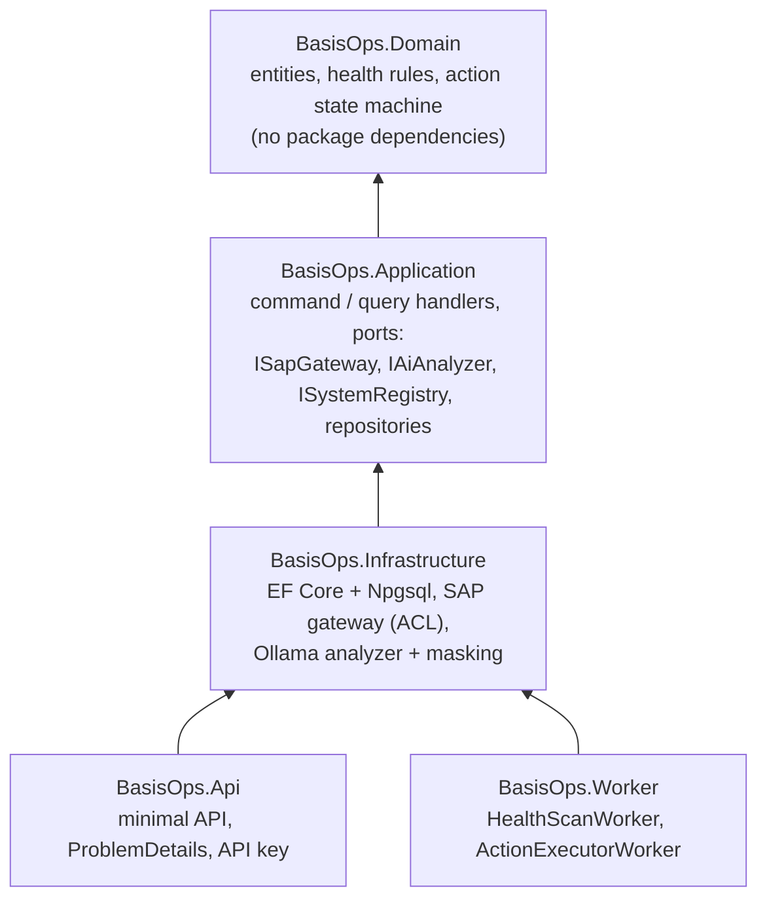
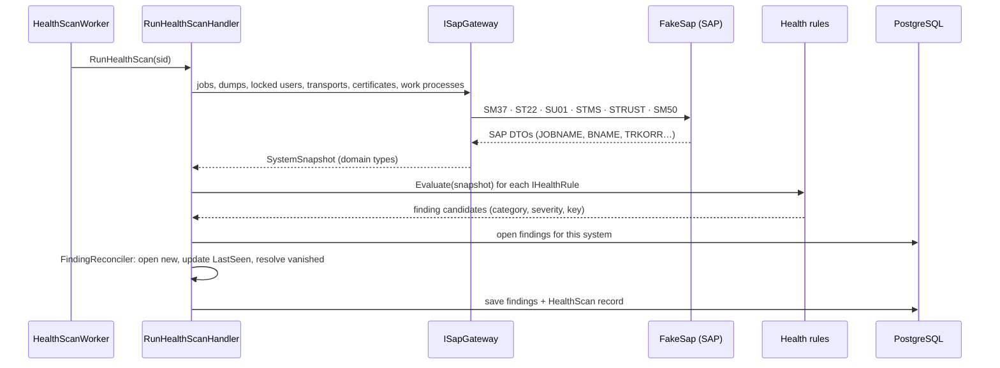
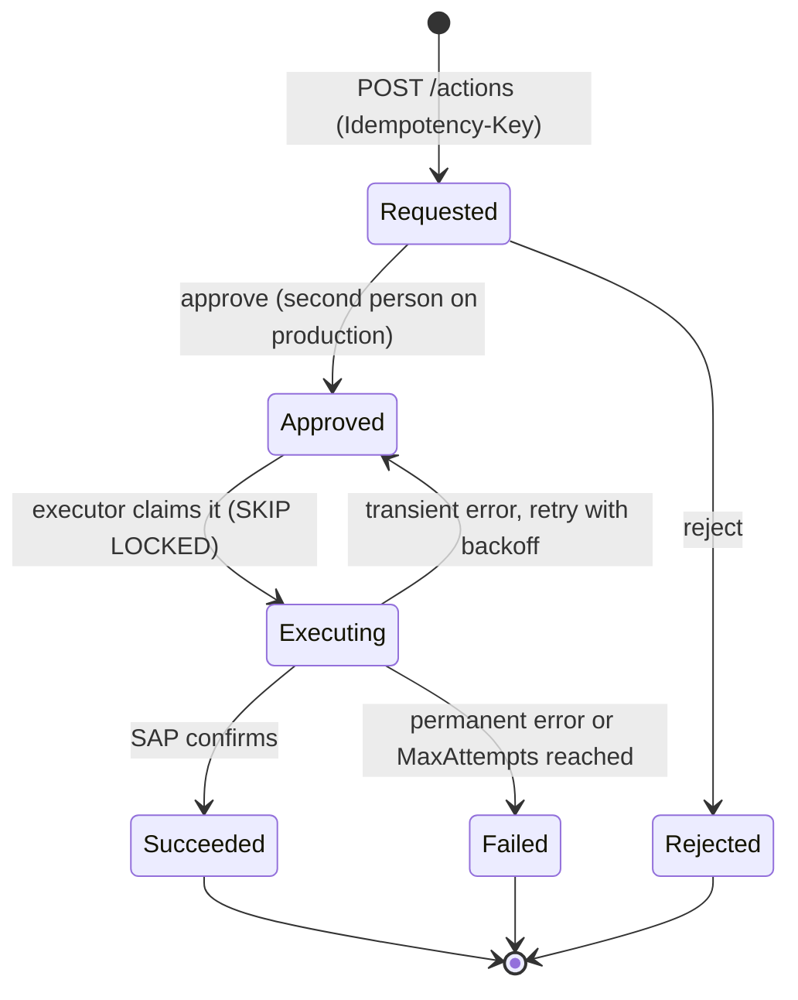
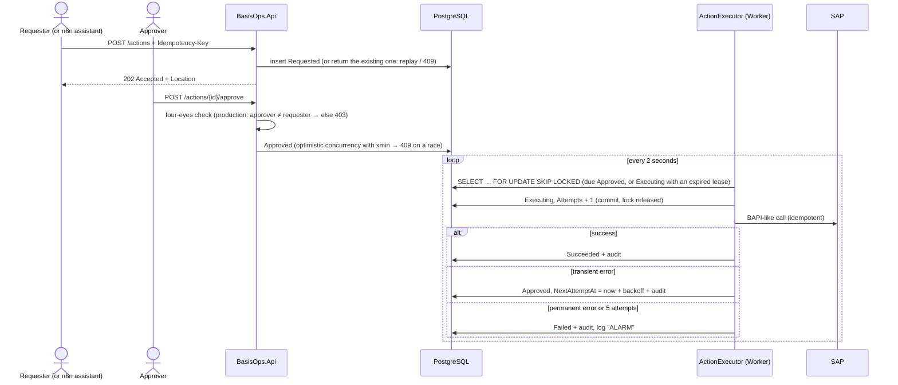
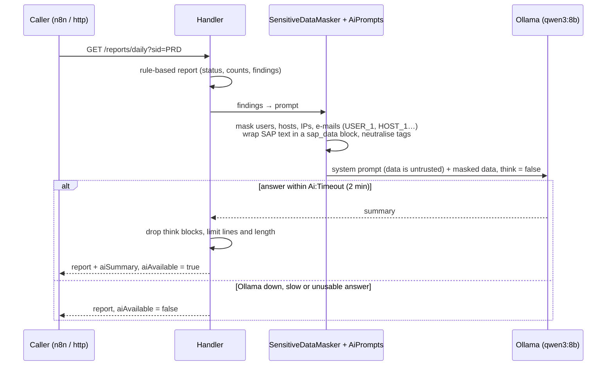

# Architecture

This document describes how the parts work together. For the overview and the reasons behind the decisions,
see the [README](../README.md).

## Layers

- **Domain** knows nothing about SAP, HTTP or the database. `ActionRequest` enforces its own transitions and returns an
  `AuditEntry` for each one; `FindingReconciler` decides which findings to open, update or resolve.
- **Application** holds the use cases. Handlers return `Result<T>`; the Api maps it to HTTP
  (Validation → 400, NotFound → 404, Conflict → 409, Forbidden → 403).
- **Infrastructure** implements the ports. SAP field names (BNAME, TRKORR, BAPIRET2…) exist only in
  `Infrastructure/Sap` and are translated into domain types there.
- **Api** and **Worker** are thin hosts. The executor logic lives in the Application layer (`ActionExecutor`),
  the worker is only the loop around it.

## Health scan

The worker scans every configured system every 60 seconds (`HealthScanWorker`, `RunHealthScanHandler`).

- Every finding has a stable **key** (for example `JOB:PRD:Z_BILLING_DAILY:<run>`). A partial unique index
  `(sid, key) WHERE resolved_at IS NULL` guarantees at most one open finding per key, even with concurrent scans.
- A finding that disappears is resolved; if it comes back later, a new finding is opened, so the history stays intact.
- If SAP cannot be reached, the scan is recorded as failed and the existing findings stay as they are.

## Action approval and execution

- **Idempotency:** the same key with the same type, system, target and requester returns the same action with
  `Idempotent-Replayed: true`; the same key with different content returns 409.
- **Concurrency:** two approvers racing → one wins, the other gets 409 (`xmin`). Several executors → each action is claimed
  by exactly one of them (`SKIP LOCKED`); the SAP call happens outside the database lock.
- **Crashes:** an action that stays `Executing` longer than the lease (2 minutes) counts as an interrupted attempt and is
  picked up again. This is safe because the SAP actions are idempotent (unlocking an unlocked user is a warning, not an error).
- **Backoff:** 5 s × 2^(attempt − 1), at most 2 minutes, ±20 % jitter. While the circuit breaker towards SAP is open,
  the action is deferred without counting an attempt.
- **Audit:** every transition writes an `AuditEntry` (actor, action, from → to state, detail) in the same transaction.

## AI: daily summary and dump analysis

- **Masking** happens before anything reaches the model. Known values (the dump's user and host) are replaced as whole words
  and case-sensitively, so the user `CAN` does not break the word "canceled". Placeholders are not translated back.
  Finding keys, which contain user names, are not sent at all.
- **Prompt injection:** SAP text is wrapped in a `<sap_data>` block that the system prompt declares untrusted data.
  Any `sap_data` tags inside the text are neutralised so it cannot close the block.
- **Structured output:** the dump analysis asks Ollama for a JSON schema (`format`) and validates the result:
  length limits, and transaction codes must look like transaction codes.
- **Fallback:** the LLM is an extra. Any failure (connection, timeout, invalid JSON, empty answer) returns the rule-based
  result with `aiAvailable: false`, never an error.
- The summary language is a setting (`Ai:SummaryLanguage`); prompts are always English.

## n8n workflows

n8n handles the schedule, the chat and Telegram; it never bypasses the API. The self-service assistant has three tools
(list locked users, request an unlock, get request status) and no approval tool. The unlock tool builds the requester
and the idempotency key from the chat session, checks that the user is really locked, and starts the Telegram approval
only for new requests. Details: [n8n/README.md](../n8n/README.md).

## Observability

Aspire's ServiceDefaults add OpenTelemetry to the Api and the Worker. The dashboard shows:

- traces for HTTP requests, the `health-scan` and `execute-action` spans (source `BasisOps.Application`) and the LLM calls
  (source `BasisOps.Ai`),
- structured logs with the action id and SID as fields,
- metrics of ASP.NET Core, HttpClient and the runtime.
