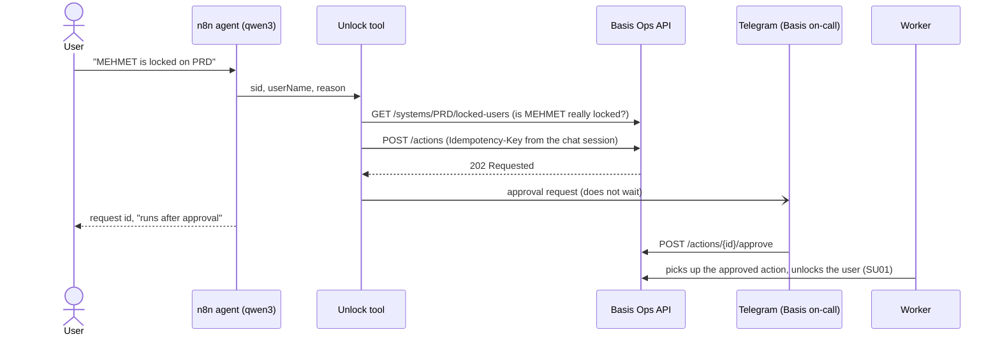

# n8n workflows

Four workflows connect the Basis Ops API to Telegram and to a chat assistant that runs on the local LLM.
They were built and tested on **n8n 2.47.5** and expect an existing n8n instance (this repo does not start one).

| Workflow | File | What it does |
|---|---|---|
| Basis Ops: Daily report | `basis-daily-report.json` | Weekdays at 08:00 (Europe/Istanbul): `GET /reports/daily`, sends an HTML message to Telegram. If the API cannot be reached, it sends a failure message instead. |
| Basis Ops: Self-service assistant | `basis-self-service-agent.json` | Chat trigger + AI Agent (Ollama `qwen3:8b`) with three tools: list locked users, request an unlock, get request status. |
| Basis Ops: Request user unlock (agent tool) | `basis-request-unlock.json` | Sub-workflow behind the `request_user_unlock` tool. Creates the action request and starts the approval for new requests. |
| Basis Ops: Action approval (Telegram) | `basis-action-approval.json` | Sends "Approve / Reject" to Telegram, waits up to 60 minutes and records the decision with `POST /actions/{id}/approve` or `/reject`. |



## Safety by design

The rules live in the workflow structure, not only in the prompt:

- The agent has **no approve or reject tool**. Approval happens only in the approval workflow, after a human clicks in Telegram.
- The model only fills in `sid`, `userName` and `reason`. The action type (`UnlockUser`), the requester
  (`self-service:<chat session>`) and the `Idempotency-Key` are set by the workflow, so the model cannot
  pose as another requester and a retried tool call cannot create a second request.
- The unlock tool checks `GET /systems/{sid}/locked-users` first: a user who is not locked (or a typo) never reaches the approvers.
- Only new requests start an approval; a replayed request (`Idempotent-Replayed: true`) does not send a second Telegram message.
- The read tools have a fixed method and path; the model only supplies the SID or the request id (URL-encoded).
- The locked-users tool calls `GET /systems/{sid}/locked-users`, which returns only user name, lock reason and time,
  not the full health payload with host and certificate details.

**Note on masking:** the API masks user names, hosts and IPs in text it sends to the LLM (dump analysis, daily summary).
The self-service agent is different: its job is to work with user names, so it sees them in clear text.
It runs on the local Ollama model and the names never leave the machine.

## Set up

1. **Start the API** (`dotnet run --project src/BasisOps.AppHost`). The n8n container reaches it at
   `http://host.docker.internal:5081`.
2. **Telegram bot:** create one with [@BotFather](https://t.me/BotFather) and find the chat id of the
   person or group that should receive reports and approvals.
3. **Import** the workflows (keeps their ids, which the sub-workflow calls rely on):

   ```bash
   n8n/import-workflows.sh                  # default container: ai-assistant-n8n-1
   ```

   Importing again overwrites the four workflows and unpublishes them; the credentials have to be selected again.

4. **Credentials** in the n8n UI (they are not part of the JSON files):

   | Credential type | Suggested name | Value | Used by |
   |---|---|---|---|
   | Header Auth | `Basis Ops API` | Name `X-Api-Key`, value = the AppHost `Parameters:api-key` | every HTTP node and tool |
   | Telegram API | `Basis Ops Telegram` | bot token from BotFather | report and approval |
   | Ollama | your existing one | `http://host.docker.internal:11434` | agent model |

5. **Settings node:** in the daily report and the approval workflow, replace `SET_YOUR_TELEGRAM_CHAT_ID`.
   `apiBaseUrl`, `sid` and `approverName` can stay as they are.
6. **Publish in this order:** n8n 2.x only publishes a workflow after the sub-workflows it calls are published.
   Approval → Request user unlock → Self-service assistant → Daily report.

To try it: run the daily report with **Execute workflow** (manual trigger), and open the chat of the
self-service assistant, for example with "PRD'de MEHMET kullanıcısı kilitlendi, açabilir misin?".

## Limits of the local setup

- **Approve from the Mac.** With the default settings, the Telegram buttons open a signed n8n link
  (`http://localhost:5678/...`). That works in Telegram Desktop on the Mac that runs n8n, not on a phone.
  For a phone, n8n needs a public HTTPS address (reverse proxy or tunnel); then the node's
  "Approve in chat" option can be used as well.
- **Approver name.** A click on a link carries no identity, so the approval is recorded as `approverName`
  from the Settings node (`BASIS_ONCALL`). In production the approver would come from the identity provider.
- **One request per chat, system and user.** The idempotency key is built from the chat session, SID and user name.
  If the same user is locked again later in the same chat, the assistant finds the old request; a new chat opens a new one.
- **Chat memory** is n8n's in-memory "Simple Memory"; it is lost when n8n restarts.
- **No answer within 60 minutes:** the request stays `Requested` and a reminder is sent; it can still be approved via the API.
- The Telegram texts are English; the AI summary inside the report follows `Ai:SummaryLanguage` (Turkish by default).

## Changing a workflow

The JSON files are exports without credentials, `instanceId` or pinned data. After changing a workflow in the UI,
export it again (`n8n export:workflow --id=<id> --output=...`), remove the `credentials` blocks and replace the
chat id with `SET_YOUR_TELEGRAM_CHAT_ID` before committing.
